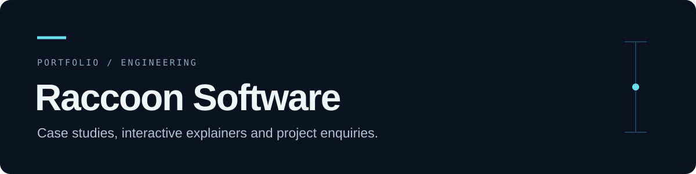
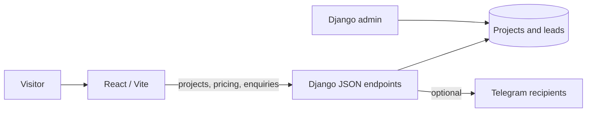

<p align="center">
  
</p>

<p align="center">
  <a href="#what-is-in-the-repository">Explore</a> ·
  <a href="#run-locally">Run locally</a> ·
  <a href="app/README.md">Frontend guide</a> ·
  <a href="backend/README.md">Backend guide</a>
</p>

# Raccoon Software / Portfolio

A software studio portfolio with routed case studies, interactive engineering
explainers and a Django content and lead-management backend. The React interface
combines project galleries, service pages and a structured project enquiry flow.

## What is in the repository

- **Portfolio and services:** responsive project galleries, pricing, process and
  service pages, with published projects and pricing editable in Django admin.
- **Engineering workspace:** architecture previews, admin-first examples, a scope
  estimator and a rental-platform case study.
- **Project enquiries:** browser-side qualification and estimate drafts, a contact
  API, persistent lead status and optional Telegram delivery to configured recipients.
- **Presentation tooling:** route metadata, motion, reusable controls and a local
  page-view/CTA event queue.

Engineering demos and estimate ranges are illustrative. Bundled seed content stays
distinct from backend-managed records. The analytics helper keeps a browser-local
event queue; an external analytics provider requires separate integration.

## Architecture



| Interface | Content and operations |
| --- | --- |
| React 19 · JavaScript · React Router | Django 5 · Python |
| Vite 7 · Tailwind CSS 4 | SQLite locally; PostgreSQL via `DATABASE_URL` |
| Framer Motion · Lucide | Django admin · WhiteNoise · Gunicorn |

The deployment image builds the frontend and serves its bundle from Django.
Separate Vite and Django processes support local development.

## Run locally

Use Node.js 22.12+ and Python 3.12 in a fresh checkout. To inspect the interface:

```bash
cd app
npm ci
npm run dev -- --host 127.0.0.1
```

Open **http://127.0.0.1:5173**. Without the backend, bundled seed projects and pricing
remain visible; a frontend preview alone cannot persist an enquiry. For the full
local flow, follow the [backend guide](backend/README.md), then start Vite with:

```bash
VITE_API_BASE=http://127.0.0.1:8000 npm run dev -- --host 127.0.0.1
```

The checked-in scripts also provide:

```bash
npm run lint
npm run build
npm run preview -- --host 127.0.0.1
```

## Navigate the source

| Path | Purpose |
| --- | --- |
| [`app/src/App.jsx`](app/src/App.jsx) | Routed portfolio, enquiry flow and seed content |
| [`app/src/pages/engineering`](app/src/pages/engineering) | Interactive engineering modules |
| [`backend/projects`](backend/projects) | Projects, images, links and pricing |
| [`backend/leads`](backend/leads) | Enquiries, admin workflow and Telegram recipients |
| [`backend/config/urls.py`](backend/config/urls.py) | Public JSON endpoints, health and SPA routing |
| [`Dockerfile`](Dockerfile) · [`DOKKU.md`](DOKKU.md) | Image build and deployment notes |

The existing Dokku notes require environment-specific configuration. No project-wide
licence file is present; no new licence grant is added here.
